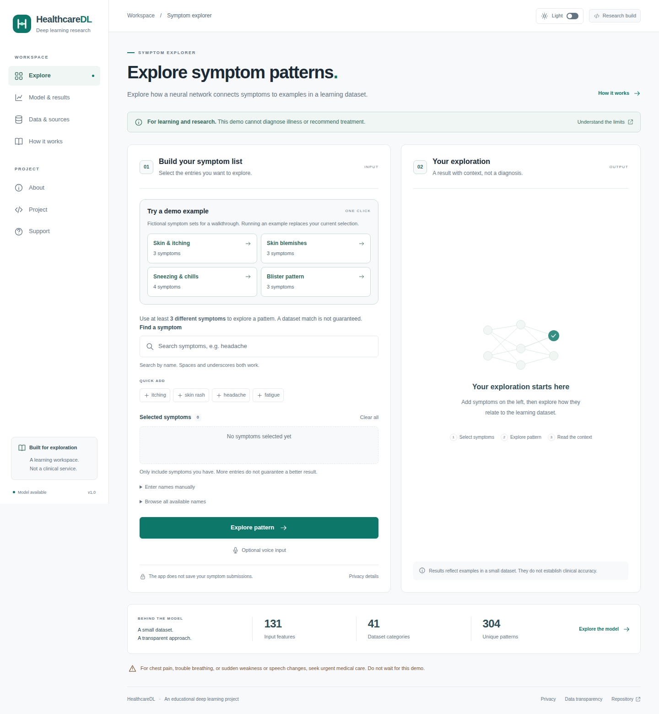

# Symptom Analysis with Deep Learning

**[Live demo — healthcaredl-resume.vercel.app](https://healthcaredl-resume.vercel.app)**

An educational PyTorch project that classifies symptom patterns into 41 dataset categories and serves the trained neural network through Flask. The model is a multilayer perceptron: **131 inputs → 128 → 64 → 41 logits**, with ReLU and dropout between hidden layers.

The report workspace adds **local blood-report OCR and reference-range comparison**, plus a separately trained **MobileNetV3 chest CT research classifier**. These pipelines have their own scope and evaluation; they do not extend the symptom model's accuracy claims.



[View the dark theme](docs/screenshots/explorer-dark.png)

This is a learning demonstration, not a diagnostic or prescribing service. The supplied data has **4,920 rows but only 304 unique patterns**, no documented patient-level provenance; public file matches and publisher license declarations are now recorded in [data/SOURCES.md](data/SOURCES.md). High dataset scores do not establish clinical performance. The app does not recommend medicines or personalized treatment.

## Run locally

Tested with Python 3.12 and CPU PyTorch. From the repository directory:

```bash
python3 -m venv .venv
source .venv/bin/activate
python -m pip install -r requirements.txt
python main.py
```

On Windows, activate with `.venv\Scripts\Activate.ps1` in PowerShell. Open <http://127.0.0.1:5000>. The checked-in `artifacts/` bundle contains the trained neural network; initial training is not required. Paths are resolved from the source directory, not the shell's working directory.

Runtime dependencies are limited to Flask and NumPy and their versions are pinned. The neural network is trained in PyTorch and exported without changing its architecture or weights. The serving export is checked against PyTorch on every unique pattern. The CPU PyTorch index is included in the separate training requirements. Debug mode is off. The built-in server is for local development; a public deployment needs an appropriate WSGI server, HTTPS, access controls for its environment, and review of infrastructure logging. This repository makes no privacy compliance claim.

## Train and evaluate

```bash
python -m pip install -r requirements-training.txt
python train.py
# Optional: use a separate destination for an experiment
python train.py --seed 20 --epochs 400 --patience 40 --output artifacts-experiment
```

Training is deterministic on the tested CPU environment. Exact results across other package versions or hardware are not guaranteed.

1. Validate binary features and normalize names. Combine duplicate `fluid_overload` columns using logical OR; this preserves the active column's signal.
2. Resolve original disease spellings to stable IDs in `data/conditions.json` and reject contradictory labels.
3. Remove duplicate patterns **before** partitioning. Split each category approximately 60/20/20 into training, validation, and test data. The default split has **182/61/61** unique patterns, with all 41 categories represented and no identical pattern shared between partitions.
4. Train with mini-batches, AdamW, cross-entropy loss, and dropout. Select a checkpoint using validation loss with early stopping. Test examples are never used for gradient updates or checkpoint selection.
5. Evaluate the selected checkpoint on the held-out test set and compare with a linear SVC trained on the same training partition. The application always serves the neural network.

Generated files:

| File | Purpose |
|---|---|
| `artifacts/model.pt` | Canonical PyTorch neural network state dictionary for research, loaded with `weights_only=True` |
| `artifacts/inference.npz` | The same dense-layer parameters, executed with NumPy in the lightweight web runtime |
| `artifacts/metadata.json` | Feature order, category IDs, inference policies, and integrity hashes |
| `artifacts/training_patterns.npz` | Training-only patterns for the unfamiliar-input heuristic; no submitted user data |
| `artifacts/report.json` | Split membership hashes, configuration, versions, learning history, per-category metrics, confusion matrices, baseline, and synthetic missing-symptom results |

Keep the artifact bundle together. When changing the schema, condition catalog, dataset, or model, retrain and replace the complete bundle. Checksums detect inconsistent files; they are not a signature or an authenticity guarantee. A missing or inconsistent model produces an unavailable state and HTTP 503 for prediction requests.

The default model achieved 100% held-out accuracy and macro F1 on the 61 test patterns. See [the model card](docs/MODEL_CARD.md) and generated report for context. Related templates can still occur across partitions. These are **pattern-level dataset results**, not independent patient-level evaluation or evidence of medical safety. Do not repeatedly tune using the held-out test results.

## Use the interface or JSON API

Choose symptoms from the available list or type comma-separated names. Case, spaces, and underscores are normalized, repeated symptoms are deduplicated, and trailing commas are accepted. Unknown names produce an actionable validation error; they are not silently dropped.

For a resume walkthrough, use the **Try a demo example** buttons. Each runs the neural network with a fictional symptom set, replaces the current selection, and labels the result as a demo. These work without JavaScript too.

| Demo example | Symptoms | Expected dataset match |
|---|---|---|
| Skin & itching | `itching, skin rash, nodal skin eruptions` | Fungal infection |
| Skin blemishes | `pus filled pimples, blackheads, scurring` | Acne |
| Sneezing & chills | `continuous sneezing, shivering, chills, watering from eyes` | Allergy |
| Blister pattern | `blister, red sore around nose, yellow crust ooze` | Impetigo |

`scurring` is the inherited feature spelling accepted by the dataset. These are demonstration inputs, not diagnostic rules. Fewer than three distinct recognized symptoms produces **More symptoms needed**, with the selected count and required minimum. Repeating a symptom does not meet the minimum. Other combinations can still produce abstentions.

```bash
curl http://127.0.0.1:5000/api/predict \
  -H 'Content-Type: application/json' \
  -d '{"symptoms":["itching","skin rash","nodal skin eruptions"]}'
```

Results use `match`, `insufficient`, `unsupported`, `uncertain`, or `urgent`. A match contains a category ID, label, educational description, and MedlinePlus reference. There are no medication lists or disease-probability claims. Urgent-care messages take precedence for designated symptoms and certain model outputs. This is not a complete or validated triage system.

Matched results also show two separately labeled percentages: **Model score** is the actual top softmax output (`model_score` in the API), an uncalibrated network score rather than a probability of illness; **Held-out test accuracy** is read from the evaluation report (currently 100% over 61 unique test patterns). The API's separate `evaluation` object contains `accuracy` as a fraction, `test_patterns`, and `scope: "held_out_dataset_patterns"`. Test accuracy does not measure the correctness of an individual result. Missing or invalid evaluation metrics display as unavailable rather than inventing an accuracy. Urgent messages and abstentions do not receive a prediction score or evaluation badge.

The demonstration abstains for fewer than 3 or more than 17 unique symptoms, maximum training-pattern Jaccard similarity below 0.5, top softmax score below 0.7, or a top-two score margin below 0.2. These thresholds are **fixed demonstration heuristics**, not clinically validated or calibrated probabilities. The report separately records the actual serving policy's match coverage and accuracy among returned matches.

Invalid requests return HTTP 400, oversized requests 413, and unavailable models 503. Successful requests, including abstentions and urgent-care messages, return 200. `GET /health` returns 200 only when a model bundle is loaded. The page itself stays accessible when a model is unavailable.

Voice input is optional and fills the same submitted field. Unsupported browsers fall back to typing. A browser speech service may process audio externally; the interface explains this before activation. The Flask app does not persist symptom submissions, print them, or learn from them. Infrastructure operators must assess their own logging and retention.

## Blood reports and chest CT

Open **Report analysis** in the navigation, or visit `/reports`.

- **Blood reports:** choose an English-language PDF, PNG, JPEG, or text file. PDF text extraction and Tesseract LSTM OCR read supported test rows, then arithmetic compares the result with the range printed on that report. Missing, conflicting, or ambiguous values are flagged for review. This is not a blood-disease prediction model; no universal ranges or diagnoses are invented. A fictional example and downloadable sample files are included.
- **Chest CT:** choose a single rendered axial chest CT slice in PNG/JPEG format. A separate CNN classifies COVID-associated versus comparator dataset patterns. Comparator does not mean healthy or COVID-negative. DICOM studies, X-rays, other body regions, and general radiology interpretation are not supported. Two published validation examples are available.

Files are processed in the current browser tab and are not uploaded or saved by the application. There are no paid inference API calls. The first CT run downloads about 19 MB of local model/runtime assets; mobile devices can take longer. Files are limited to 10 MB and PDFs to five pages. Report processing requires JavaScript and a browser with WebAssembly support.

The CT model achieved **96.77% accuracy on 496 held-out images** after training on 1,487 images and selecting its checkpoint using 496 validation images. This is **not a patient-separated evaluation**: patient identifiers are unavailable in the downloaded archive, and related slices may cross partitions. No clinical accuracy is established. The CT percentages are separate from the symptom model's metrics.

See [report analysis and reproducible training](docs/REPORT_ANALYSIS.md), [dependency/data attribution](docs/THIRD_PARTY.md), and [the workspace preview](docs/screenshots/reports.png).

```bash
python tools/check_medical_assets.py
# Optional CT retraining, after downloading the public archive:
python -m pip install -r requirements-imaging-training.txt
python tools/train_chest_ct.py
```

## Notebook and checks

[Symptom Analysis Deep Learning.ipynb](Symptom%20Analysis%20Deep%20Learning.ipynb) runs the same preprocessing, training, evaluation, and inference code. Select the project environment as its Python kernel. Its plots require the development dependencies.

```bash
python -m pip install -r requirements-dev.txt
python -m pytest -q
```

Browser checks use an installed Chrome/Chromium or Playwright's Chromium. If neither is available, they are skipped with an installation message:

```bash
python -m playwright install chromium
python -m pytest -q tests/test_browser.py
```

Checks cover duplicate leakage, feature merging, label alignment, deterministic training, reloadable neural weights, artifact corruption, abstention, emergency precedence, malformed requests, paths, UI submission, voice input, mobile layout, and theme preferences across submissions, navigation, reloads, and tabs.

Report checks include actual text and scanned PDFs, image OCR, units and range boundaries, ambiguous/duplicate rows, file validation, CT bundle corruption, browser/PyTorch numerical agreement, and requests confirming that medical files are not uploaded. Standalone JavaScript parser checks use Node when it is installed; report browser checks use the same Chrome/Playwright setup.

## Data and project structure

- `healthdl/`: shared schema, neural model, training, and inference.
- `train.py`: reproducible training command; `main.py`: Flask application factory and routes.
- `Training.csv`: unchanged original training data; see [dataset notes](docs/DATASET.md).
- `data/conditions.json`: stable IDs, original aliases, short educational descriptions, and source links. References were checked on 2026-11-11; this does not constitute clinical review.
- `data/legacy/`: archived original lookup tables and SVC pickle. They contain known inconsistencies and are **not loaded** by the application or training pipeline.
- `templates/`, `public/static/`: local UI assets; no Bootstrap or other third-party CDN is needed.
- `tests/`: data, model, application, and browser checks.

Public publisher downloads have now been compared against the original files: the complete training table matches after removing one unused column, and the archived severity file matches byte-for-byte. Publisher license declarations and attribution are recorded in [data/SOURCES.md](data/SOURCES.md), with repeatable evidence in `data/provenance.json`. Original clinical collection and rights in other inherited assets remain unverified. The publisher test file overlaps the original training table in 41 of 42 rows and is not an independent patient benchmark.

See [deployment instructions](docs/DEPLOYMENT.md) for Vercel and Docker/Gunicorn. Independent evaluation support is available through `evaluate.py`; see [the external evaluation protocol](docs/EXTERNAL_EVALUATION.md). The [clinical review record](docs/CLINICAL_REVIEW.md) remains pending qualified review. These remaining evidence requirements cannot be completed by code changes alone.

## Professional workspace

The interface includes searchable symptom selection, removable selections, responsive navigation, a model-results dashboard, actual learning curves, data/source transparency, and a privacy notice. The app uses a newly authored vector mark; the original unverified logo is archived. No analytics or third-party asset CDN is required.

Use the light/dark switch in the header on any page to change the theme. The app initially follows your device preference; a manual choice is remembered across pages and visits in this browser's local storage. Only the theme preference is stored there. If browser storage is unavailable, switching still works on the current page. Without JavaScript, the interface remains usable in light mode.

A project-local `.venv` can be used for local work. For deployment, connect your Vercel account or import the repository, following [docs/DEPLOYMENT.md](docs/DEPLOYMENT.md). Do not upload personal datasets or secrets.
